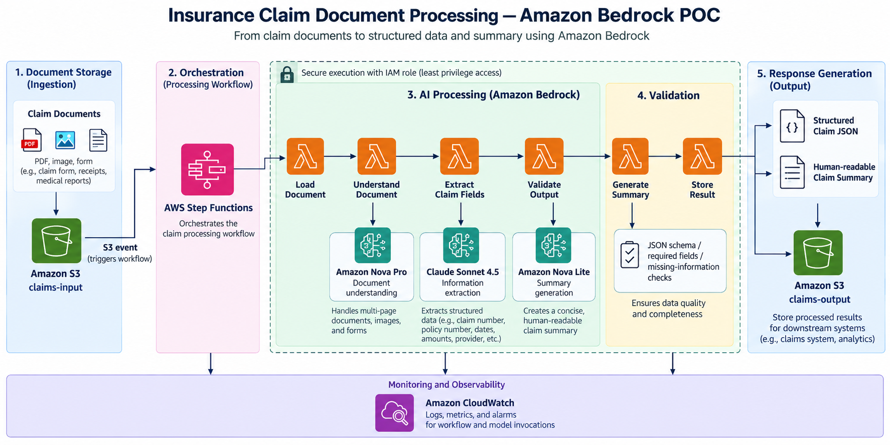

# Automated Insurance Claim Processing on Amazon Bedrock

## Use case

An insurance company receives claim submissions as unstructured text
documents. Staff read each document, copy the key values into the claims
system, look up the governing policy, and write a summary for an adjuster.
The work is slow, inconsistent between reviewers, and hard to audit.

This proof of concept automates the reading and summarizing steps with
Amazon Bedrock while keeping a human in the loop for the decision itself.
For one claim document it:

1. Reads the claim document from Amazon S3.
2. Extracts the structured fields with a foundation model.
3. Validates the extracted data against a strict schema, rejecting anything
   malformed before it moves downstream.
4. Retrieves the governing policy document that the claim references.
5. Generates a summary grounded only in that policy.
6. Persists the structured claim, the summary, and inference metrics to S3.

The pipeline does **not** approve, deny, or determine coverage.
It assembles the facts an adjuster needs and leaves the judgment to them.

### Project plan

- Step 1. Design the architecture
- Step 2. Implement the proof of concept
- Step 3. Create reusable components (prompt template manager, model
  invoker, content validator)
- Step 4. Test and evaluate (2-3 sample documents, compare models, document
  findings and recommendations)

## Architecture

The diagram below is the **target architecture** for a production
deployment. It is the Step 1 design, not a picture of what runs today.



### What this proof of concept actually implements

This is a simple POC. The six processing stages in the diagram
are real and run in the order shown, but they execute as sequential method
calls inside one local Python process rather than as deployed AWS services.

| Target architecture | This proof of concept |
|---|---|
| S3 event triggers the workflow | Run manually from the command line |
| AWS Step Functions orchestrates | Sequential stages in `processor.py` |
| One Lambda function per stage | One method call per stage |
| A different model per stage | One configurable model for both calls |
| Separate input and output buckets | One bucket with prefixes |
| IAM execution role | A local AWS named profile |
| CloudWatch logs and alarms | Console output and token metrics |

Only Amazon S3 is provisioned by Terraform. Amazon Bedrock is called
directly with the AWS SDK. Keeping the orchestration local means the whole
pipeline can be read, run, and debugged in one process, which is the point
of a proof of concept.

Claim documents are plain text. There is no retry, queueing, or
concurrency beyond what the AWS SDK provides.

Moving to the target architecture would mean packaging each stage in
`processor.py` as a Lambda handler, wiring them with a state machine, and
adding the IAM roles and CloudWatch resources to Terraform. The component
boundaries in `src/claim_poc/` were drawn with that split in mind.

## Repository structure

```
claim-processing/
├── README.md                       This document
├── architectural-diagram.png       Solution architecture
├── pyproject.toml                  Package metadata, dependencies, pytest config
│
├── infra/                          Terraform for the S3 data store
│   ├── providers.tf                AWS provider and named profile
│   ├── versions.tf                 Terraform and provider version pins
│   ├── variables.tf                Input variables
│   ├── locals.tf                   Derived naming values
│   ├── s3.tf                       Claim bucket definition
│   └── outputs.tf                  Exposes claim_bucket_name
│
├── src/claim_poc/                  Reusable application components
│   ├── config.py                   Central configuration and S3 key layout
│   ├── storage.py                  S3 read, write, list, existence checks
│   ├── model_invoker.py            Bedrock Converse API wrapper
│   ├── prompt_manager.py           Versioned prompt templates
│   ├── validator.py                Pydantic claim schema and business rules
│   ├── policy_retriever.py         Policy lookup for grounding
│   └── processor.py                End-to-end workflow orchestration
│
├── scripts/                        Operational entry points
│   ├── get-data.py                 Download the source dataset into S3
│   ├── build-claims.py             Generate claim documents and ground truth
│   ├── build-policies.py           Generate the matching policy documents
│   ├── run-claim.py                Process a single claim end to end
│   └── evaluate-models.py          Compare models and score against truth
│
├── tests/
│   ├── unit/                       Local, mocked, no AWS calls
│   │   ├── test_validator.py
│   │   ├── test_processor.py
│   │   └── test_policy_retriever.py
│   └── integration/                Live Bedrock and S3 calls
│       ├── test_model.py
│       ├── test_extraction.py
│       └── test_claim_extraction.py
│
└── data/claims/claims_data.csv     Local copy of the source dataset
```

The S3 bucket holds the working data under these prefixes:

```
claims/source/      The source dataset
claims/documents/   Generated unstructured claim documents
claims/expected/    Ground-truth values for each claim
policies/           Policy documents used for grounding
results/            Processed claim output
evaluations/        Model comparison runs
```

## Prerequisites

- Python 3.11 or later
- Terraform
- An AWS account with Amazon Bedrock model access enabled
- An AWS named profile with permission to use S3 and Bedrock

## Setup

```bash
python3 -m venv .venv
source .venv/bin/activate
pip install -e ".[dev]"

terraform -chdir=infra init
terraform -chdir=infra apply
```

Configuration is read from the environment, so no source change is needed to
switch accounts, regions, or models:

| Variable | Default | Purpose |
|---|---|---|
| `AWS_PROFILE` | `default` | AWS named profile |
| `AWS_REGION` | `us-east-1` | AWS region |
| `BEDROCK_MODEL_ID` | `us.amazon.nova-lite-v1:0` | Default model |
| `CLAIM_BUCKET` | Terraform output | Override the bucket name |

## Implementation order

The components were built in the order below. Each step depends only on the
ones above it.

### Step 1. Infrastructure and foundations

| Order | File | Purpose |
|---|---|---|
| 1 | `infra/*.tf` | Provision the versioned S3 bucket that stores every artifact |
| 2 | `src/claim_poc/config.py` | Single source of truth for profile, region, model, and every S3 key. Resolves the bucket from `CLAIM_BUCKET` or Terraform output |
| 3 | `src/claim_poc/storage.py` | Thin S3 wrapper. Turns a missing object into `FileNotFoundError` so callers handle one exception type |

### Step 2. Test data

| Order | File | Purpose |
|---|---|---|
| 4 | `scripts/get-data.py` | Download the public synthetic claims dataset and upload it to `claims/source/` |
| 5 | `scripts/build-claims.py` | Turn three CSV rows into unstructured claim documents and write the matching ground-truth JSON to `claims/expected/` |
| 6 | `scripts/build-policies.py` | Generate one policy document per policy number **referenced by those claims**, selecting a template by claim type |

### Step 3. Reusable components

| Order | File | Purpose |
|---|---|---|
| 7 | `src/claim_poc/model_invoker.py` | Wraps the Bedrock Converse API. Returns a normalized response with text plus token and latency metrics, so any Converse-compatible model is a drop-in swap |
| 8 | `src/claim_poc/prompt_manager.py` | Holds the `extract_claim` and `generate_summary` templates. Keeping prompts in one module lets them be versioned and compared independently of the integration code |
| 9 | `src/claim_poc/validator.py` | Pydantic schema with business rules: positive amounts, plausible ages, no unexpected fields, placeholder names normalized to null |
| 10 | `src/claim_poc/policy_retriever.py` | Deterministic policy lookup by policy number. Isolated behind an interface so it can later be replaced with a Bedrock knowledge base |

### Step 4. Orchestration, entry point, and evaluation

| Order | File | Purpose |
|---|---|---|
| 11 | `src/claim_poc/processor.py` | Runs the six workflow stages, tolerates markdown-fenced JSON, and normalizes the summary to a single clean line |
| 12 | `scripts/run-claim.py` | CLI entry point. Prints its configuration before any AWS call, so a stall is attributable to a specific stage |
| 13 | `tests/unit/`, `tests/integration/` | Mocked unit tests for logic, live tests for the AWS integration |
| 14 | `scripts/evaluate-models.py` | Scores each candidate model field by field against ground truth, checks summary guardrails, records tokens and latency |

## Running the pipeline

```bash
# One-time data preparation
python scripts/get-data.py
python scripts/build-claims.py
python scripts/build-policies.py

# Process a single claim
python scripts/run-claim.py --claim-id CLM-2024-001

# Compare models
python scripts/evaluate-models.py
```

## Testing

```bash
pytest tests/unit          # local, no AWS calls, no cost
pytest tests/integration   # live Bedrock and S3 calls
```

## Step 4. Findings

### Results

Nine runs per model, three claims repeated three times.

| Model | Fields correct | Accuracy | Schema valid | Guardrail flags | Input tokens | Output tokens | Mean latency | Range |
|---|---|---|---|---|---|---|---|---|
| Nova Micro | 72/72 | 100% | 9/9 | 0 | 6675 | 2446 | 1423 ms | 1267-1613 |
| Nova 2 Lite | 72/72 | 100% | 9/9 | 1 | 6759 | 2149 | 1833 ms | 1511-2707 |
| Nova Lite | 72/72 | 100% | 9/9 | 0 | 6675 | 2490 | 1850 ms | 1533-2152 |
| Nova Pro | 72/72 | 100% | 9/9 | 0 | 6675 | 2429 | 2113 ms | 1707-2393 |
| Claude Haiku 4.5 | 72/72 | 100% | 9/9 | 0 | 6352 | 2315 | 2281 ms | 892-2956 |
| Llama 4 Scout | 56/72 | 77.8% | 7/9 | 0 | 4313 | 1361 | 872 ms | 0-1558 |

Latency is the combined time of both inference calls for one claim. Token
counts are totals across all nine runs.
